     

  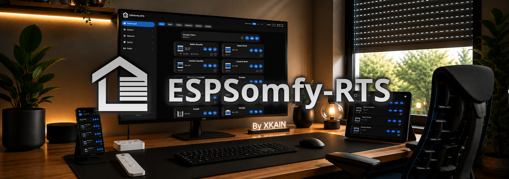

   

  

    Easily control and monitor your roller shutters, gates, garage doors, or any other device using the RTS 433 MHz protocol.
     
     
    <a href="https://github.com/xkain/ESPSomfy-RTS/blob/main/README_fr.md"><strong>README complet en français 🇫🇷 »</strong></a>
     
    <a href="https://github.com/xkain/ESPSomfy-RTS/wiki"><strong>Explore the documentation »</strong></a>
     
    <a href="https://github.com/xkain/ESPSomfy-RTS/issues">Report a bug</a>
    &middot;
    <a href="https://github.com/xkain/ESPSomfy-RTS/pulls">Request a feature</a>
  

 

  <a href="images/exemple.png">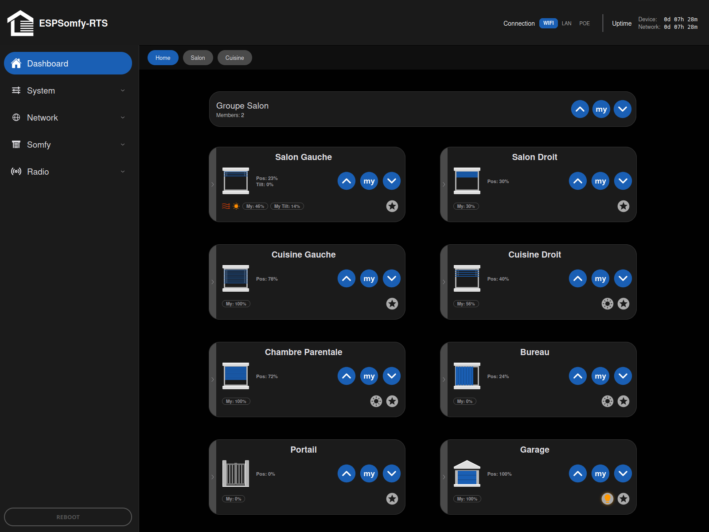</a>

## About the project

**ESPSomfy-RTS** turns an ESP32 and a 433 MHz radio module into a gateway for your **Somfy RTS** devices: roller shutters, blinds, gates, garage doors. Other brands of the Somfy group — SIMU, Teleco, BFT — sell them too: their **RTS** models are driven the same way. Your original remotes keep working — the device listens to them to keep its display in sync.

This repository is a **fork** of [rstrouse](https://github.com/rstrouse/ESPSomfy-RTS)'s project. The radio foundations are his; what changed sits on top.

| | |
| --- | --- |
| **Capacity** | 30 devices, 14 groups, 14 rooms, 7 linked remotes per device |
| **Protocols** | RTS, RTW, RTV/L, and wired motors through relay modules |
| **Languages** | English, French, German, Spanish |
| **Integrations** | Home Assistant, MQTT with auto-discovery, REST API |
| **Updates** | from the interface, downloaded straight from GitHub |

#### What this fork brings

* **A redesigned, genuinely responsive interface.** The phone is no longer a fallback screen: it is a control panel.
* **Multilingual**, with the whole interface translated.
* **Radio wizards laid out step by step.** Pairing a motor, linking a remote, adding a device to a group: every step is numbered, explained, and asks for one thing at a time — with an **expert mode** that collapses it all onto a single page once you know the move. A separate wizard pre-configures the ready-made units.
* **A radio board selector.** Your module's GPIO pins are picked from a list covering the most common ESP32 boards.
* **Hardened security.** Secrets no longer leave the device, and repeated attempts run into a guard.
* **A two-level reset**: network and security only, or a full factory wipe.
* **A real-time graph on the frequency scan**, so you watch the remote stand out from the noise while you search, instead of only reading the result.

And much more…

#### Supported protocols
* **433 MHz RTx:** full support for the **RTS, RTW, RTV/L** protocols and **433.92 MHz**.
* **Frequency constraints:** you can mix protocols as long as they stay within the same base frequency range.
  > **Note:** you cannot run 433.92 MHz and 433.42 MHz motors at the same time on a single radio transceiver.
* **IO Homecontrol:** not natively supported. Compatibility can still be achieved through the **IO Remote** protocol, by interfacing with a stripped-down remote.

#### Wired motors (relays)
For "bare" motors with no built-in radio, the project supports **relay module configurations**. Once set up, those motors are driven from the interface exactly like native RTS or RTW devices.

 

### Why does this project exist?

**ESPSomfy-RTS** is a powerful project at its core, but I felt it needed a more modern and localised touch.

Being French (and therefore a big fan of bread and cheese), I found during my very first use that the explanations were sometimes confusing. Above all, I felt like I had to put on sunglasses every time I opened the interface! This fork is designed to save you a trip to the eye doctor and a few linguistic headaches along the way.

While keeping the **rock-solid foundations** of the original project, I entirely rethought the user experience to make it **truly responsive**: the interface is just as pleasant on a phone or a tablet as on a desktop, and navigation is finally clear for non-English speakers.

This project aims to make managing your 433 MHz RTS devices as good-looking as it is functional.

 

## Migration & updates

#### Coming from rstrouse's firmware

> [!WARNING]
> **Do not move from v2.4.6/v2.4.7 to this fork through the Firmware page of rstrouse's interface.** That route is not supported: it replaces only half of the system and leaves an interface and a firmware that do not understand each other. Do a full USB install with the "onboard" image — see the **[installation guide](https://github.com/xkain/ESPSomfy-RTS/wiki/Guide-d'installation)**.

* **Your data follows.** A `.backup` file from the original project restores here: devices, groups and remote addresses are carried over, and your motors do not need to be paired again.
* **Except the radio GPIO pins.** The board selector introduced by this fork cannot guess them from an older file: you have to reassign them by hand in the **Radio** tab.
* **A compatibility warning appears** during the restore. It is expected, and it does not mean the restore failed.

#### Coming from an earlier version of this fork

* **Updating from the interface preserves your configuration**, with nothing to do on your side.
* **The automatic backup taken just before the update stays in the old format.** If you reload that particular file later, you will hit the compatibility warning and the GPIO reassignment again.

> [!TIP]
> Right after a successful update, create a **fresh backup**. It carries the current GPIO mapping and will never trigger that warning again.

## Home Assistant

Two integrations work with this firmware.

#### ESPSomfy-RTS Enhanced — recommended

**[ESPSomfy-RTS Enhanced](https://github.com/xkain/ESPSomfy-RTS-enhanced)** is the version dedicated to this fork: it can authenticate against a device protected by a PIN, it shows the firmware release notes at update time, and it exposes the sensors specific to this line.

* **Installation:** from the Home Assistant **Marketplace** (*Settings → Marketplace*, built in since Home Assistant 2026.11), or by clicking the button below. On an older version of Home Assistant, it installs the same way through **HACS** (*Home Assistant Community Store*), which the Marketplace has taken over from.

#### rstrouse's ESPSomfy-RTS-HA — compatible, with two caveats

If you already use the original integration, your entities, devices and automations keep working normally — provided your entities keep the same ids. Two limits worth knowing:

* **Firmware release notes are not shown** in Home Assistant: that integration does not have the feature.
* **Full security cuts its access for good.** Every request it makes gets a `401` and its WebSocket is refused: it does not send an API key, and it learns that authentication is required from a response that is itself refused. It cannot recover on its own.

> [!IMPORTANT]
> **The "configuration only" mode is what makes the difference.** It protects the configuration screens alone and leaves open the routes an integration needs: an active security setting then breaks nothing at all.
>
> It is the **default since v2.6.0**, on a new or factory-reset device. An update, however, keeps whatever was already stored: if your device is older, check that box under `System` > `Security` **before** setting a PIN.
>
> For full protection, move to ESPSomfy-RTS Enhanced **v2.6.0 or newer**: it knows how to authenticate.

## Project ESPSomfy-RTS Roadmap

Want to know what's coming next, check current release progress, or see completed features? I use GitHub Projects to maintain a live, up-to-date roadmap.

> 💡 **Click the badge above** to track real-time development, active milestones, and submit features or bug fixes directly into the workflow columns.

 

## 🛠️ Troubleshooting & factory reset

If you lose access to the web interface (a network misconfiguration, a forgotten password), a manual reset procedure is available through **power cycles**.

> [!IMPORTANT]
> The reset works on **two levels**, so that you are not forced to lose everything when only the network is at fault.

### Procedures at a glance

* **3 power cycles:** resets the Wi-Fi configuration and disables the security settings. Your devices, groups and rooms are kept.
* **6 power cycles:** full factory reset (**full wipe**).

### 📖 Full documentation
For detailed instructions and the cycle diagrams, see the dedicated page:

👉 **[Go to the Factory Reset page](https://github.com/xkain/ESPSomfy-RTS/wiki/Factory-Reset)**

> [!TIP]
> Always treat these procedures as a last resort. If the interface still answers, use the **Restore** button in the system settings instead.

---

## 📸 Screenshots

*Click a screenshot to open it at full resolution.*

#### 📱 Mobile — dark mode

  <a href="images/dark-mobile00.png">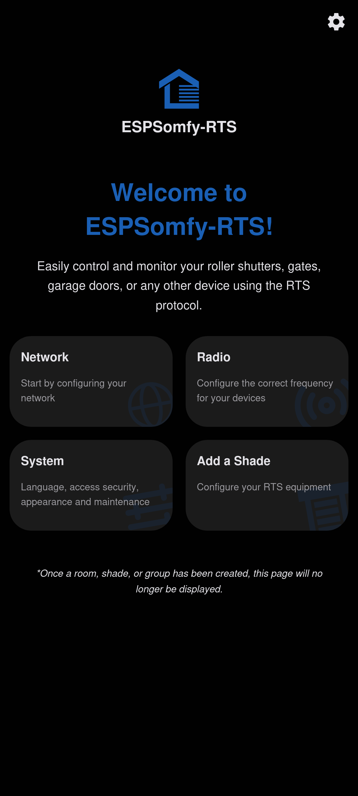</a>
  <a href="images/dark-mobile01.png">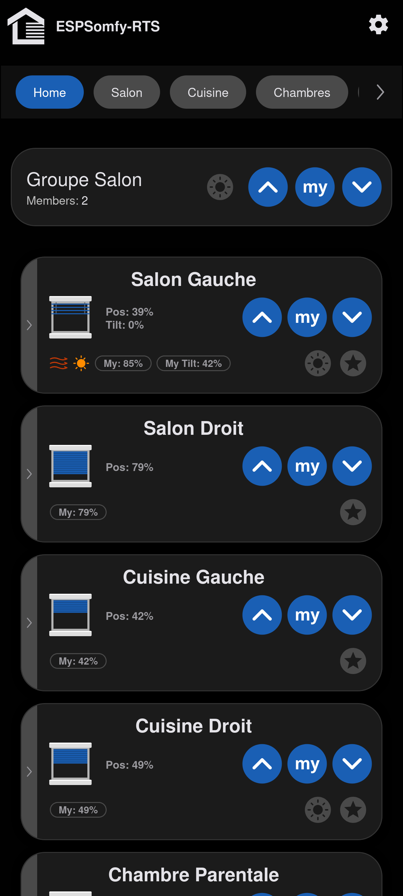</a>
  <a href="images/dark-mobile02.png">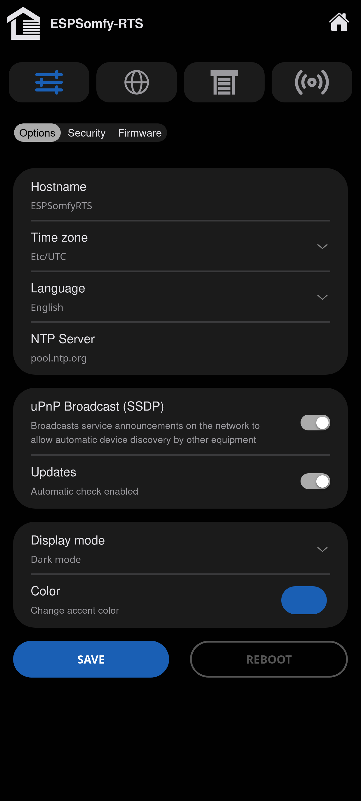</a>
  <a href="images/dark-mobile03.png">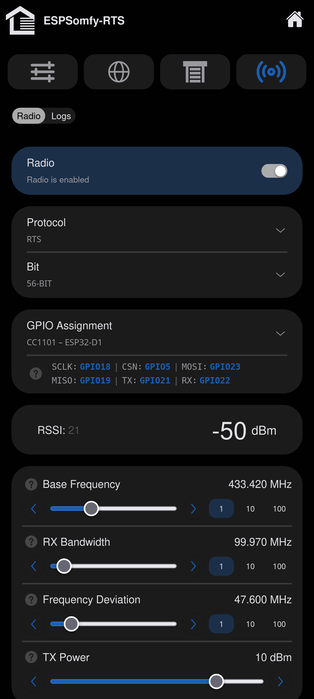</a>

#### 💻 Desktop — dark mode

  <a href="images/dark00.png">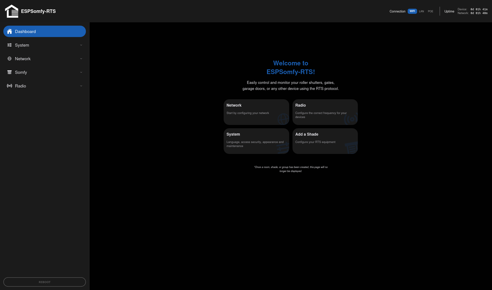</a>
  <a href="images/dark02.png">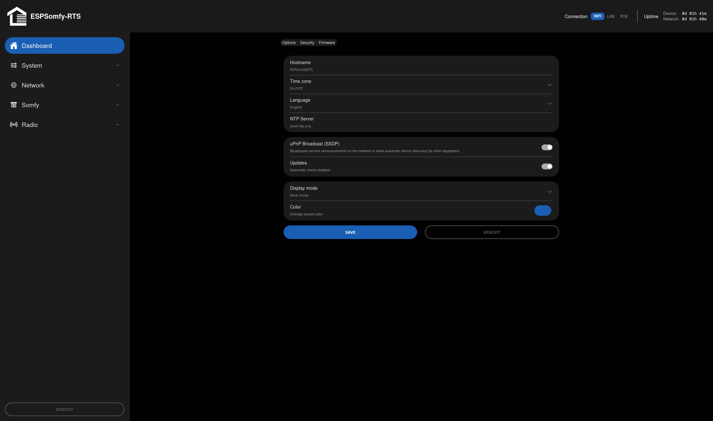</a>
  <a href="images/dark03.png">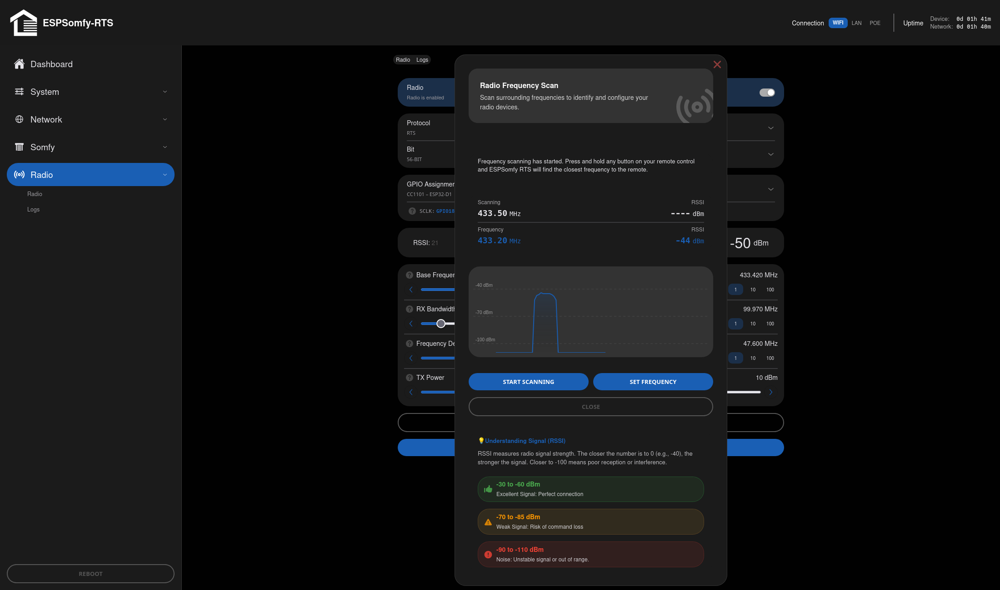</a>

<b>✨ See the same screens in light mode</b>

 

  <a href="images/clair-mobile00.png">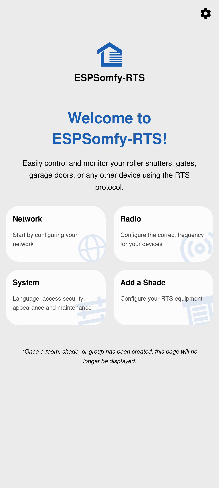</a>
  <a href="images/clair-mobile01.png">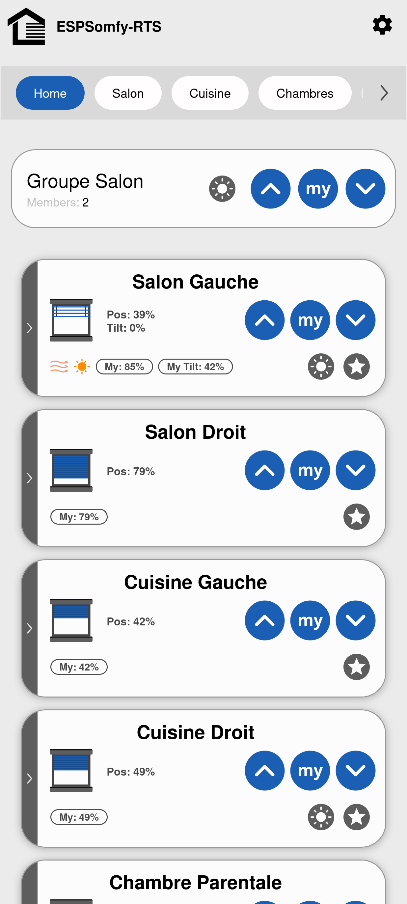</a>
  <a href="images/clair-mobile02.png">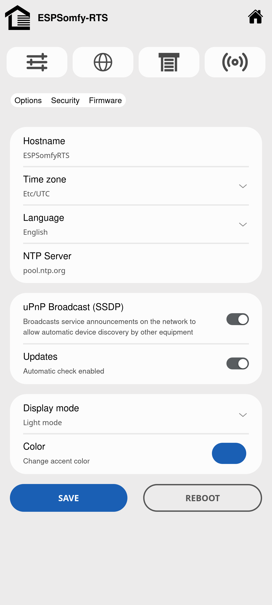</a>
  <a href="images/clair-mobile03.png">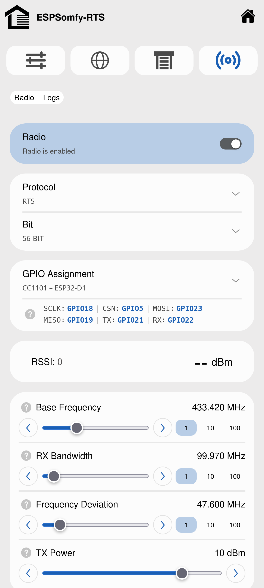</a>

  <a href="images/clair00.png">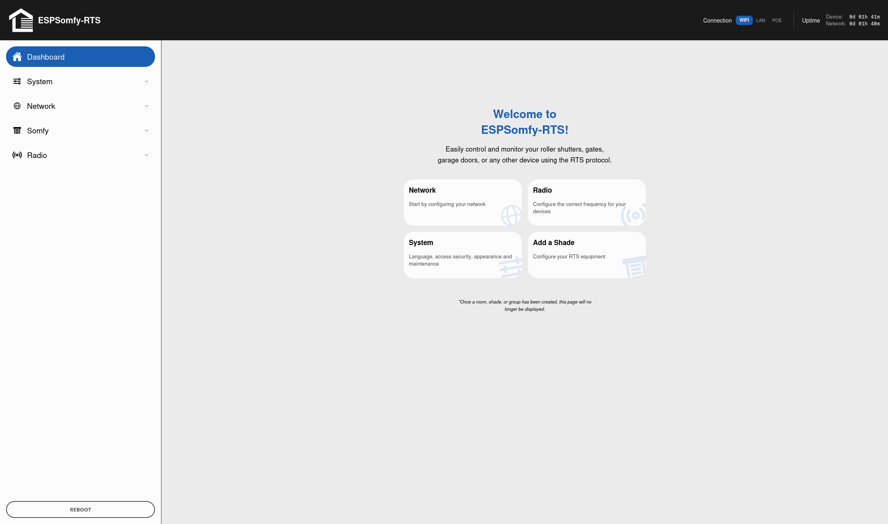</a>
  <a href="images/clair02.png">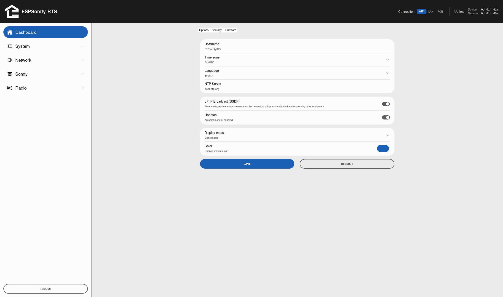</a>
  <a href="images/clair03.png">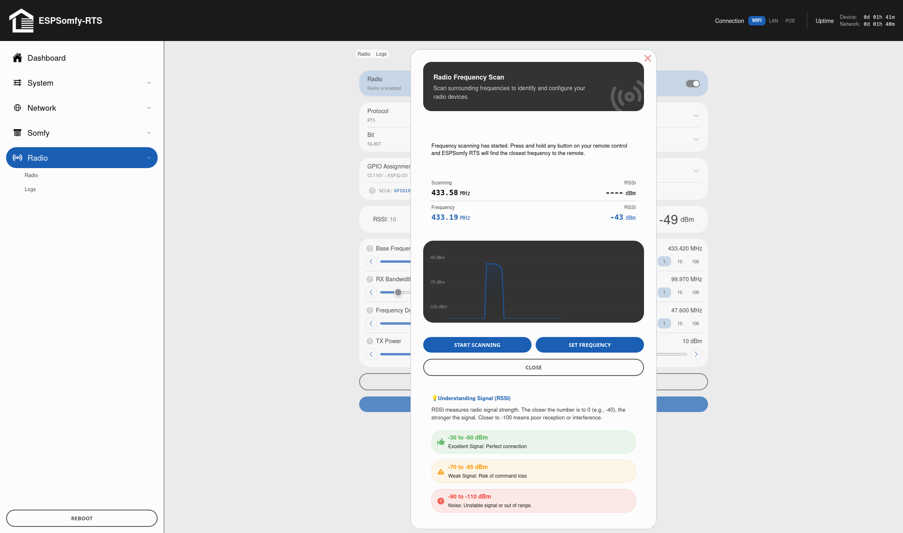</a>

---

## 📚 Documentation & resources

This fork's documentation lives in its **[wiki](https://github.com/xkain/ESPSomfy-RTS/wiki)**: one page per screen of the interface, kept current with the latest published release.

> [!NOTE]
> The wiki is **written in French**. Your browser's translation handles it well, and the screenshots speak for themselves.

* **[Installation guide](https://github.com/xkain/ESPSomfy-RTS/wiki/Guide-d'installation)** — flashing an ESP32 over USB from the browser, and arriving from rstrouse's firmware.
*  **[Dashboard](https://github.com/xkain/ESPSomfy-RTS/wiki/Tableau-de-bord)** — a tour of the interface: group and device cards, buttons, indicators and the positioning windows.
* **[Devices](https://github.com/xkain/ESPSomfy-RTS/wiki/EQUIPEMENTS)** and **[Groups](https://github.com/xkain/ESPSomfy-RTS/wiki/GROUPES-(Groups))** — creating an entry, timing the travel, pairing the motor, linking your physical remotes.
* **[Radio setup](https://github.com/xkain/ESPSomfy-RTS/wiki/Configurer-la-Radio)** — GPIO assignment, frequency tuning, and a worked case when some devices do not answer.
* **[Updating](https://github.com/xkain/ESPSomfy-RTS/wiki/Mettre-%C3%A0-jour)** — the three update windows and the thirteen files published by a *release*.
* **[Integrations](https://github.com/xkain/ESPSomfy-RTS/wiki/Int%C3%A9grations)** — REST API, MQTT and Home Assistant.

---

## Credits

Special thanks to **[rstrouse](https://github.com/rstrouse)**, the author of the original ESPSomfy-RTS project, for his incredible work.

### Contributors

Thanks to those who take the time to move the project forward:

  <a href="https://github.com/y-streibel-uiris">y-streibel-uiris</a>
  &middot;
  <a href="https://github.com/glich34">glich34</a>
  &middot;
  <a href="https://github.com/dirstel">dirstel</a>
  &middot;
  <a href="https://github.com/Peethiplatsch">Peethiplatsch</a>
  &middot;
  <a href="https://github.com/jcrespoc">jcrespoc</a>

---

> 🇫🇷 **Ready-made units.** I also build and sell fully assembled, flashed and tested units. They are sold **in France only**, so the specifications, the two editions and the ordering details live in the **[French README](https://github.com/xkain/ESPSomfy-RTS/blob/main/README_fr.md)**.
